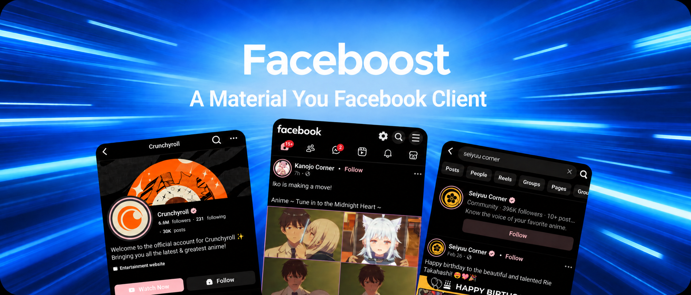

<p align="middle">
    
</p>

<p align="middle">
    <a href="README.md">English</a> · <b>Español</b>
</p>

<p align="center">
    <a href='https://github.com/Ufoex/Faceboost/releases/latest'></a>
    <a href='https://grev.shehryar.ae/?owner=Ufoex&repo=Faceboost'></a>
    <a href='https://buymeacoffee.com/masterllamk'></a>
</p>

<p align="center">
    🙋 ¿Problema o sugerencia? <a href='https://github.com/Ufoex/Faceboost/issues/new/choose'>Abre un issue</a> &nbsp;·&nbsp; ☕ ¿Te gusta la app? <a href='https://buymeacoffee.com/masterllamk'>Invítame un café</a>
</p>

<p align="middle">
    📸 También disponible: <a href='https://github.com/Ufoex/Instaboost'><b>Instaboost</b></a>, la misma idea para Instagram.<br>
    🎵 Y <a href='https://github.com/Ufoex/Spotiboost'><b>Spotiboost</b></a>, para Spotify.
</p>

<h2 align="middle">
    ✏️ Sobre este repositorio
</h2>

La app se llama **Faceboost** (antes Materialbook). El repositorio también cambió de nombre; la dirección antigua redirige aquí. El nombre de paquete sigue siendo `com.ufoex.materialbook` para que las actualizaciones reemplacen la app instalada.

Este **no es un proyecto original**. Es un repositorio que reúne en una sola app los cambios de otros forks de
[Materialbook](https://github.com/eepiemi/Materialbook). Casi todo el código lo escribieron las personas de la tabla; este repo solo lo une y compila el APK
(se publica una versión nueva con cada push a `main`).

| Autor original | Proyecto | Qué aportó |
|---|---|---|
| [eepiemi](https://github.com/eepiemi) | [Materialbook](https://github.com/eepiemi/Materialbook) | La app base |
| [ofirc73](https://github.com/ofirc73) | [AstryxBook](https://github.com/ofirc73/AstryxBook) | PiP para reels, audio con la pantalla bloqueada, video a pantalla completa, vertical en teléfonos, la capa de Mensajes, descargas de archivos más seguras |
| [dh6k](https://github.com/dh6k) | [Materialbook_fork](https://github.com/dh6k/Materialbook_fork) | Redirección a Messenger, enlaces externos, bloqueo de anuncios reforzado, visor de fotos y mejoras de rendimiento del feed |
| [farhun1](https://github.com/farhun1) | [BraveBook](https://github.com/farhun1/BraveBook) | Bloqueo de anuncios y rastreadores con la lista de Brave, ocultar publicaciones de grupos |
| [Kdomy](https://github.com/Kdomy) | [LiteBook](https://github.com/Kdomy/LiteBook) | Copiar el texto de una publicación, descargas fiables de videos y reels, arreglo del login AMOLED |
| [Ufoex](https://github.com/Ufoex) | Este fork | Controles de reels, desplazamiento automático y audio con la pantalla apagada para reels, un visor de reels más estable, barra superior plegable, búsqueda de actualizaciones |

Mira [FORK_CHANGES.md](./FORK_CHANGES.md) para los detalles. Los colores Material You y el negro AMOLED vienen desactivados (de AstryxBook); ambos son opciones en Ajustes.

<h2 align="middle">
    ⚙️ Funciones
</h2>

La mayoría son opciones en los Ajustes de la app.

Activadas por defecto:
*  Bloquea anuncios patrocinados
*  Mantiene la barra de navegación arriba
*  Descarga contenido o lo copia al portapapeles
*  Vuelve a la página en la que estabas cuando Android cierra la app en segundo plano, con una fila en Ajustes para excluirla del ahorro de batería
*  Aparece en el menú de compartir de Android (enlaces, texto, imágenes, videos) y los envía a un chat dentro de la app o en la app Messenger
*  Mantén pulsado el icono de la app para ver accesos directos a Mensajes, Búsqueda, Marketplace, Reels y Notificaciones
*  Abre enlaces de Facebook desde otras apps, incluidos `fb.me`, `fb.com` y los enlaces `fb://` de la app de Facebook
*  Busca en GitHub una versión nueva al abrir la app (Ajustes → *Buscar actualizaciones al iniciar*); *Buscar actualizaciones ahora* lo hace a demanda, y el diálogo descarga el nuevo APK
*  Controles de reels: tiempo, barra de progreso, pantalla completa y volumen en reels pausados (también con los iconos ocultos), un botón para ocultar los iconos del reel (con desvanecimiento; en el sitio de escritorio el video llena la pantalla) y, opcionalmente, ajuste de tamaño para ver el video completo sin recortes. Funcionan en el teléfono y en el sitio de escritorio
*  El diseño de escritorio se puede desactivar en tablets: Facebook envía entonces el sitio móvil, al ancho completo de la pantalla
*  Se mantiene en vertical en teléfonos y tablets al navegar (el video a pantalla completa gira), salvo que el diseño de escritorio esté activo y *Orientación de escritorio* sea horizontal o automática (experimental); los archivos de caché antiguos se borran al iniciar la app
*  "Compartir vía..." en el menú de compartir de Facebook, y una opción para ejecutar solo los scripts incluidos en la app
*  Bloqueo de la app (Ajustes, desactivado por defecto): huella, rostro o PIN del teléfono para abrirla
*  Llamadas y videollamadas de Messenger en la capa de Mensajes (pide cámara y micrófono al iniciar una llamada); filas para cerrar sesión y compartir la página en Ajustes
*  Exporta e importa tus ajustes como archivo; la capa de Mensajes gira a horizontal; tamaño de texto del 85% al 150%
*  Gestos en reels (Ajustes, desactivado por defecto): mantén pulsado un reel para acelerarlo, doble toque a la izquierda o derecha para saltar de 5 a 30 segundos

Desactivadas por defecto (opcionales):
*  Abre enlaces a otros sitios web en una Custom Tab (la pestaña de tu navegador sobre la app)
*  Mantiene la pantalla encendida mientras se reproduce un video, o siempre
*  Usa colores Material You en lugar de los azules de Facebook (el azul de Facebook es el tema por defecto)
*  Pone Facebook en negro AMOLED
*  Oculta distracciones como:
    *  Publicaciones sugeridas
    *  Reels
    *  Historias
    *  Grupos
    *  Personas que quizá conozcas
*  Avisa de mensajes nuevos, notificaciones y solicitudes de amistad cada 15 minutos aproximadamente (Ajustes → Notificaciones de Facebook)
*  Oculta las barras del sistema (modo inmersivo), o solo la barra de navegación / línea de gestos (Ocultar barra de navegación)
*  Desplazamiento automático de reels: pasa al siguiente cuando termina el actual, con un botón en el visor para pausarlo
*  Mantiene el audio de un reel con la pantalla apagada, con un botón en el visor de reels
*  Barra superior plegable: las barras de arriba se ocultan al bajar y vuelven al subir (necesita Barra de navegación fija) (teléfono y sitio de escritorio)
*  Permite pellizcar para hacer zoom en cualquier parte
*  Permite acceder a Messenger (solo con diseño de escritorio)
*  Abre Mensajes dentro de la app en el sitio de escritorio, en su propia capa sobre el feed, de modo que Atrás te devuelve donde estabas (Ajustes → *Mensajes en modo escritorio*); los enlaces a una conversación la conservan
*  Reproducción en Picture-in-Picture con proporciones de ventana vertical a elegir
*  Mantiene el audio de un video en Picture-in-Picture al bloquear la pantalla

Siempre activas:
*  Mantiene en su sitio el reel que ves cuando Facebook reconstruye la lista de reels o se oculta un anuncio, y funde la miniatura con el video al empezar
*  Video a pantalla completa real, también en horizontal, desde el botón de pantalla completa de Facebook
   (en teléfonos la app se queda en vertical, porque el sitio móvil de Facebook falla en horizontal)
*  El video a pantalla completa gira con el sensor, aunque la rotación automática del sistema esté apagada
*  Idiomas: inglés, árabe, bengalí, alemán, hebreo (`עברית`), italiano, español, francés, portugués y chino tradicional
*  ¡Y más!

<h2 align="middle">
    🖼️ Picture-in-Picture
</h2>

Para usar Picture-in-Picture:

1. Activa **Picture-in-Picture** en los Ajustes de la app.
2. Toca **Proporción de PiP** (aparece al activar PiP) y elige la proporción de la ventana para videos verticales:
   * **4:7** (recomendada; por defecto)
   * **2:3**
   * **3:4**
   * **9:16** (puede salirse de la pantalla en algunos dispositivos)
3. Si hace falta, permite también PiP en Android en **Ajustes > Apps > Materialbook > Picture-in-picture**.
4. Abre un video o Reel de Facebook y empieza a reproducirlo.
5. Mantén el video visible y con sonido, y usa el gesto o el botón de Inicio.

En Android 12 y posteriores, PiP está configurado para una transición automática fluida al salir
de la app. En versiones anteriores compatibles, PiP se activa cuando Android avisa a la app de que se la abandona.

La app ignora la reproducción automática sin sonido del feed y elige el video visible con sonido más grande
cuando hay varios. Los videos horizontales usan su proporción de origen detectada cuando está disponible,
como 7:4, 4:3 y 16:9, con 16:9 como alternativa si no se conocen las dimensiones.
Los videos verticales usan la proporción elegida en Ajustes, y un cambio de selección se aplica de inmediato
al video activo sin reiniciar la app.

La proporción 4:7 por defecto es un buen compromiso: se acerca a la forma real 9:16 del video
y evita la ventana desproporcionada o fuera de pantalla que se ve en algunos dispositivos. Las ventanas más anchas
4:7, 2:3 y 3:4 recortan arriba y abajo lo necesario para llenar la ventana PiP sin bandas negras.
Elegir 9:16 conserva la forma exacta del video, pero la ventana puede salirse en algunos dispositivos.
Las proporciones horizontales extremas se ajustan al rango que admite PiP en Android.

La página se oculta en PiP para que solo se vea el video, llenando la ventana.
Girar el teléfono mientras un video está en PiP mantiene el mismo video en reproducción.

Para seguir escuchando con la pantalla bloqueada, activa también **Mantener audio al bloquear la pantalla**
(bajo los ajustes de PiP). Al bloquear la pantalla con un video en PiP, su audio pasa a un reproductor nativo,
con controles multimedia en la pantalla de bloqueo. Al desbloquear, vuelve al video en la misma posición.
Los enlaces de video de Facebook caducan con el tiempo, así que el audio durante un bloqueo muy largo puede cortarse; el video
se restaura igualmente donde se quedó.

Android/Chromium pausa el video en cuanto empieza PiP (una limitación de la plataforma que
una app no puede evitar): toca el botón de Reproducir en la ventana PiP para reanudarlo.

Si PiP no aparece, confirma que el video se está reproduciendo con el volumen por encima de cero
y que están activados tanto el permiso de la app como el de PiP del sistema Android.

<h2 align="middle">
    🛠️ Instalación para desarrollo
</h2>

Materialbook requiere Android 8.0 (API 26) o superior.

1.  **Clona el repositorio**
    * En Android Studio:
      * File > New > Project from Version Control
      * Pega `https://github.com/Ufoex/Faceboost.git` y clona.
    * O desde la terminal:
    ```
    git clone https://github.com/Ufoex/Faceboost.git
    cd Faceboost
    ```
2.  **Abre en Android Studio.** (solo si clonaste desde la terminal)
    * Elige Open an Existing Project y la carpeta clonada.
3.  **Sincroniza el proyecto** para descargar las dependencias.
4.  **Ejecuta la app** en un dispositivo o emulador.

<h2 align="middle">
    ✅ Pruebas
</h2>

Cubren el cambio de marca y de comportamiento por defecto de este fork: valores por defecto (Material You/AMOLED desactivados), colores del tema, identidad/textos de la app, icono del lanzador, applicationId y el origen fijado de los scripts.

*  **Pruebas unitarias** (sin dispositivo ni emulador): `./gradlew test`
*  **Lint de Android** (sin dispositivo ni emulador): `./gradlew :app:lintDebug`
*  **Pruebas instrumentadas** (necesitan un dispositivo conectado o un emulador): `./gradlew connectedAndroidTest`

GitHub Actions ejecuta las tres comprobaciones. Los informes de lint se suben como artefacto en cada ejecución. El filtro de lint trata los avisos de actualización de dependencias como informativos, pero sigue fallando ante problemas accionables de Android.

<h2 align="middle">
    💗 Agradecimientos:
</h2>

*  Este es un fork de [Materialbook](https://github.com/eepiemi/Materialbook) de eepiemi, a su vez un fork de [Nobook](https://github.com/ycngmn/Nobook) de ycngmn
*  [@KevinnZou/compose-webview-multiplatform](https://github.com/KevinnZou/compose-webview-multiplatform)

Faceboost no está afiliado ni respaldado por Facebook ni Meta. Facebook es una marca de Meta Platforms, Inc.
